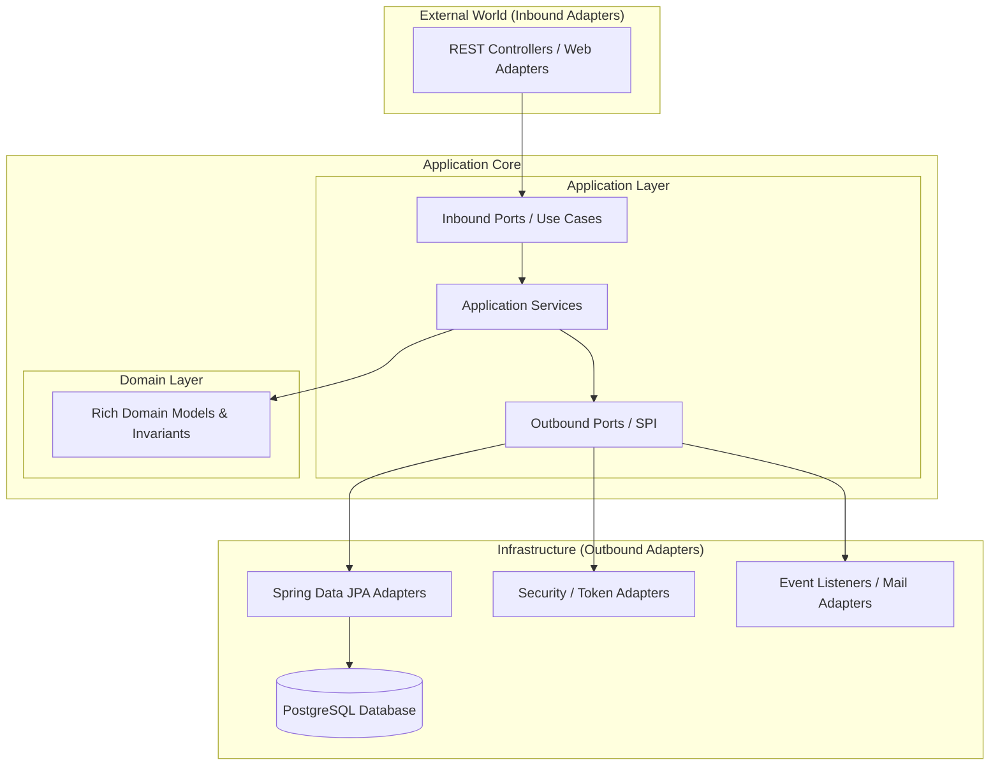

# Expenses Tracker Backend 💰

A modern, scalable, and secure RESTful backend service for a personal finance and expense tracking system.

The project is engineered following **Hexagonal Architecture (Ports & Adapters / Clean Architecture)** and **Domain-Driven Design (DDD)** principles, featuring decoupled Bounded Contexts and a Rich Domain Model.

---

## 🏛 Architecture Overview

The system architecture is designed to strictly decouple business rules and domain logic from infrastructure details (frameworks, databases, and third-party services).



### Bounded Contexts

1. **`user`** — Manages user accounts, profiles, and account-level settings (default ISO-4217 currency, soft deletion, account restoration).
2. **`authentication`** — Handles registration, credentials (`UserCredentials`), one-time email verification tokens (`EmailVerificationToken`), and password reset tokens (`PasswordResetToken`).
3. **`session`** — Manages user sessions, issuance, and rotation of refresh tokens (`RefreshToken`) with built-in token reuse detection.

> [!NOTE]
> Bounded Contexts communicate with each other **strictly via identifiers (`UUID userId`)** and application port contracts (`UserAccountPort`), avoiding cross-module Hibernate object relationships (`@OneToOne`, `@ManyToOne`). This eliminates circular dependencies, tight coupling, and N+1 query issues.

---

## 🛡 Security & Reliability Highlights

- **Token Hashing at Rest**: No sensitive tokens (refresh tokens, verification tokens, password reset tokens) are ever stored in plain text. Only cryptographic SHA-256 hashes (`tokenHash`) are persisted in the database.
- **Refresh Token Rotation (RTR)**: Each token refresh marks the previous token as revoked (`revokedAt`), links it to the replacement (`replacedByTokenId`), and issues a new token pair.
- **Token Reuse Detection**: If an already revoked token is used (indicating a potential token theft/replay attack), the system immediately **invalidates all tokens within the compromised session family**.
- **User Enumeration Protection (OWASP Top 10)**: Password reset requests (`RequestPasswordResetService`) finish silently when a non-existent email is provided, preventing attackers from probing registered email addresses.
- **Transactional Event Listeners**: Asynchronous side-effects such as sending emails (`VerificationEmailEventListener`) leverage `@TransactionalEventListener(phase = TransactionPhase.AFTER_COMMIT)`. Emails are dispatched only if the database transaction commits successfully.
- **Pessimistic Locking (`@Lock(PESSIMISTIC_WRITE)`)**: Single-use token validation and token rotation prevent race conditions and double-spending under concurrent requests.
- **Deterministic Time-Travel Testing**: All temporal operations rely on `java.time.Clock`, enabling robust and predictable time-travel unit testing without manipulating the system clock.

---

## 🛠 Tech Stack

- **Language**: Java 17
- **Framework**: Spring Boot 4.x (WebMVC, Data JPA, Security, Validation)
- **Database**: PostgreSQL 16+
- **Database Migrations**: Flyway
- **API Documentation**: SpringDoc OpenAPI 3 / Swagger UI
- **Security**: Spring Security, DelegatingPasswordEncoder (BCrypt / Argon2)
- **Boilerplate Reduction**: Lombok
- **Containerization**: Docker, Docker Compose

---

## 📂 Project Structure

```text
src/main/java/rostyslav/sharuiev/expenses/
├── authentication/                         # Authentication Bounded Context
│   ├── application/
│   │   ├── event/                          # Domain & integration events (email requests)
│   │   ├── port/
│   │   │   ├── in/                         # Inbound ports (Use Cases: register, verify, reset)
│   │   │   └── out/                        # Outbound ports (SPI: token repositories, hashers)
│   │   └── service/                        # Use Case implementations
│   ├── domain/
│   │   ├── enums/                          # Domain enumerations (OAuthProvider)
│   │   └── model/                          # Rich Domain Models (UserCredentials, Tokens)
│   └── infrastructure/
│       ├── config/                         # Configuration properties and beans
│       ├── messaging/                      # Transactional event listeners (@TransactionalEventListener)
│       ├── persistence/                    # Authentication persistence layer
│       │   ├── adapter/                    # Persistence adapters implementing Out ports
│       │   ├── entity/                     # JPA entities
│       │   ├── mapper/                     # Domain <-> JPA entity mappers
│       │   └── repository/                 # Spring Data JPA repositories
│       └── security/                       # Hashing, token generation, and password adapters
├── session/                                # Session & Refresh Token Context
│   ├── application/
│   │   ├── exception/                      # Session-specific domain exceptions (token reuse)
│   │   ├── port/
│   │   │   ├── in/                         # Session Use Cases (create, rotate, revoke)
│   │   │   └── out/                        # Outbound ports (token repositories, token generators)
│   │   └── service/                        # Session orchestration service
│   ├── domain/
│   │   └── model/                          # RefreshToken Rich Domain Model & state transitions
│   └── infrastructure/
│       ├── config/                         # Session TTL properties and configuration
│       └── persistence/                    # Session persistence layer
│           ├── adapter/                    # RefreshToken persistence adapter
│           ├── entity/                     # RefreshToken JPA entity
│           ├── mapper/                     # RefreshToken persistence mapper
│           └── repository/                 # Spring Data RefreshToken repository
└── user/                                   # User Account & Profile Context
    ├── application/
    │   ├── port/
    │   │   ├── in/                         # User Use Cases & command DTOs
    │   │   └── out/                        # User repository SPI ports
    │   └── service/                        # User account application service
    ├── domain/
    │   └── model/                          # User Rich Domain Model with profile & currency invariants
    └── infrastructure/
        └── persistence/                    # User persistence layer
            ├── adapter/                    # User persistence adapter
            ├── entity/                     # User JPA entity
            ├── mapper/                     # User persistence mapper
            └── repository/                 # Spring Data User repository
```

---

## 🚀 Getting Started

### Prerequisites
- **JDK 17** or higher
- **Docker** & **Docker Compose**
- **Maven** (or the included Maven Wrapper `mvnw`)

### 1. Clone the Repository
```bash
git clone https://github.com/RostyslavSharuiev/expenses-backend.git
cd expenses-backend
```

### 2. Start PostgreSQL via Docker Compose
A ready-to-use PostgreSQL service is defined in `docker-compose.yaml`:
```bash
docker compose up -d
```
The database will be accessible at `localhost:5432`.

### 3. Application Configuration
Configuration settings are located in [`src/main/resources/application.yaml`](file:///d:/Desktop/expenses-backend/src/main/resources/application.yaml).

Key configuration properties:
```yaml
spring:
  datasource:
    url: jdbc:postgresql://localhost:5432/expenses
    username: postgres
    password: root

  jpa:
    hibernate:
      ddl-auto: validate   # Schema is managed via Flyway migrations

app:
  authentication:
    email-verification-token-ttl: 24h
    password-reset-token-ttl: 30m
  session:
    refresh-token-ttl: 30d

server:
  port: 9090
```

### 4. Build and Run the Application

**Linux / macOS:**
```bash
./mvnw clean spring-boot:run
```

**Windows (PowerShell):**
```powershell
.\mvnw.cmd clean spring-boot:run
```

During startup, Flyway automatically executes all pending SQL migrations found in `src/main/resources/db/migration/`.

The application starts on port **`9090`**.

---

## 🗄 Database & Migrations

The database schema is versioned using Flyway migrations:
- [`V1__create_initial_schema.sql`](file:///d:/Desktop/expenses-backend/src/main/resources/db/migration/V1__create_initial_schema.sql): Initial schema definition:
  - `users` — User account records, profile details, and default currency.
  - `user_credentials` — Password hashes and change audit timestamps.
  - `oauth_accounts` — Federated identity links (Google, etc.).
  - `refresh_tokens` — Session audit log and rotation replacement chain.
  - `email_verification_tokens` — One-time email address confirmation tokens.
  - `password_reset_tokens` — One-time password recovery tokens.

---

## 📖 API Documentation (OpenAPI / Swagger UI)

Once the application is running, the interactive API documentation is available at:
- **Swagger UI**: [http://localhost:9090/swagger-ui.html](http://localhost:9090/swagger-ui.html)
- **OpenAPI JSON**: [http://localhost:9090/v3/api-docs](http://localhost:9090/v3/api-docs)

---

## 📋 Roadmap

- [x] Hexagonal Architecture core setup (DDD, Bounded Contexts).
- [x] Account registration with email verification token generation.
- [x] Secure password reset flow with active session revocation.
- [x] Session lifecycle model with Refresh Token Rotation (RTR).
- [x] Flyway migrations and strict schema validation.
- [ ] Complete `AuthenticateUseCase` and `RotateRefreshTokenUseCase` services.
- [ ] Implement `AccessTokenProviderPort` (JWT) and `EmailSenderPort` adapters.
- [ ] REST API Controllers (`AuthController`, `UserController`) and `SecurityFilterChain` setup.
- [ ] Expense Management module: expense categories, transactions, multi-currency support.
- [ ] Budgeting and personal finance analytics.

---

## 👤 Author

- **Rostyslav Sharuiev** — [GitHub Profile](https://github.com/RostyslavSharuiev)
